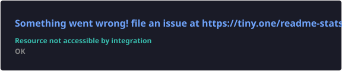

**B.E. Artificial Intelligence & Data Science · Pune, India**

---

## 👩‍💻 About Me

I'm a third-year **Artificial Intelligence & Data Science** engineering student who likes turning ideas into working software. My work spans **machine learning, computer vision, OCR, Python web apps (Flask) and SQL/ETL-based analytics**.

- 🔭 **Focus:** practical, real-world projects: healthcare reminders, face-based age classification, banking reports
- 🌱 **Learning:** deep learning, backend development, system design, BI dashboards
- 🎯 **Goal:** an AI / software engineering internship, then a full-time engineering role
- 🤝 **Open to:** internships, collaborations and hackathons

---

## 🛠️ Tech Stack

**Languages & Web**

**AI, ML & Data**

Also used: MediaPipe · EasyOCR · Matplotlib

**Databases & Data Engineering**

SQL · SSIS · ETL pipelines · banking MIS reporting

**Tools**

<!--
  Add these only once you're comfortable listing them:
  Power BI, Tableau, Excel  ->  
-->

---

## 🚀 Featured Projects

### 💊 [MedicineReminderAI](https://github.com/PratikshaRaskar/MedicineReminderAI)
AI-based **medicine adherence prediction and voice reminder** system. It reads prescriptions with OCR, predicts adherence with a machine-learning model, and manages medicines and reminders through a Flask dashboard.

`Python` `Flask` `Scikit-learn` `OpenCV` `EasyOCR` `SQLite` `HTML/CSS/JS`

🔗 [Repository](https://github.com/PratikshaRaskar/MedicineReminderAI) · 🌐 [Live demo](https://medicinereminderai-production.up.railway.app/)

 

### 🏦 [Cosmos Data Analytics Internship](https://github.com/PratikshaRaskar/Cosmos-Data-Analytics-Internship)
Work log and deliverables from a 2026 data analytics internship: **SQL practice queries, SSIS ETL packages and banking reports**, plus a weekly daily diary.

`SQL` `SSIS` `ETL` `Banking MIS`

🔗 [Repository](https://github.com/PratikshaRaskar/Cosmos-Data-Analytics-Internship)

### 🧑‍🦳 [Age Detection](https://github.com/PratikshaRaskar/Age_Detection)
Classifies human faces into **age groups** using a model trained on a labeled facial-image dataset.

`Python` `Jupyter Notebook` `Computer Vision`

🔗 [Repository](https://github.com/PratikshaRaskar/Age_Detection)

### 📘 [ML-Algorithm](https://github.com/PratikshaRaskar/ML-Algorithm)
A running log of **daily machine learning concepts, algorithms, notes and implementations**.

`Python` `Jupyter Notebook`

🔗 [Repository](https://github.com/PratikshaRaskar/ML-Algorithm)

---

## 💼 Experience

| Role | Organization | Period |
|---|---|---|
| Data Analytics Intern | Cosmos Internship (SQL, SSIS, ETL, banking reports) | 2026 |
| AI–ML Virtual Intern, **Outstanding Grade (O)** | EduSkills Foundation (AICTE) | Oct 2025 – Dec 2025 |
| Intern: AI, Data Science & IoT | Bharat Forge Ltd. | Sep 2023 – Nov 2023 |

## 🎓 Education

- **B.E. Artificial Intelligence & Data Science**, MMIT Lohgaon (2024 – 2027)
- **Diploma in Engineering**, AISSMS Polytechnic (2021 – 2024)

---

## 📊 GitHub Stats

Cards are generated by a scheduled GitHub Action (see <code>.github/workflows/grs.yml</code>) and show public data only.

<!--
  Optional contribution animation (add only if you want it; needs its own workflow):
  https://github.com/Platane/snk
-->

---

## 🌍 Open-Source Mindset

I'm early in my open-source journey and focused on the fundamentals:

- Building useful projects and publishing them with clear READMEs, screenshots and setup steps
- Improving code quality and documentation as I go
- Learning from other people's repositories and how they structure real projects
- Collaborating with developers and contributing to relevant projects as opportunities come up

## 📚 Currently Learning

- Deep learning and computer vision
- Backend development and system design
- Advanced SQL, ETL and data analytics / BI dashboards
- Better software engineering practices (testing, documentation, clean structure)

## 🏆 Certifications & Achievements

- 🥇 **AI–ML Virtual Internship**, AICTE & EduSkills Foundation (Outstanding Grade)
- ☁️ **Generative AI Studio**, Google Cloud
- 🥽 **AR/VR Acceleration Program**
- 💡 **E-FEST 2025 Hackathon**, JSPM

<!-- Tip: link each item to its certificate or credential URL as proof. -->

---

## 📫 Connect With Me

⭐ Feel free to explore my repositories. I'm happy to talk about internships, collaborations and hackathons.

